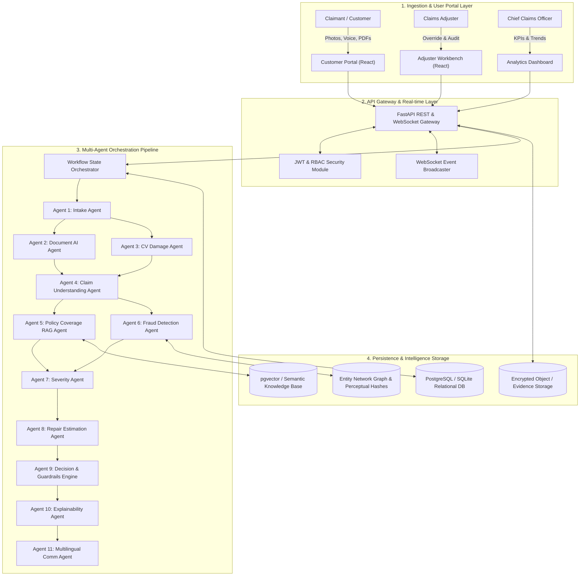
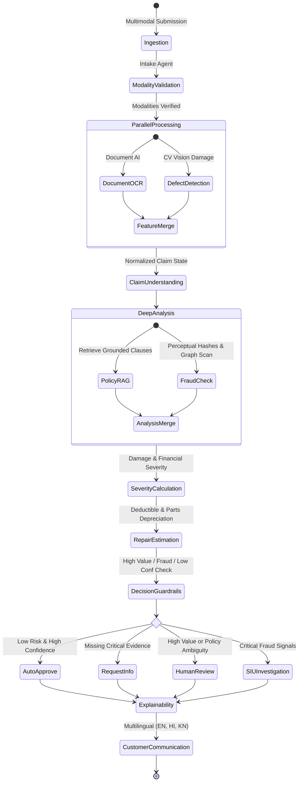
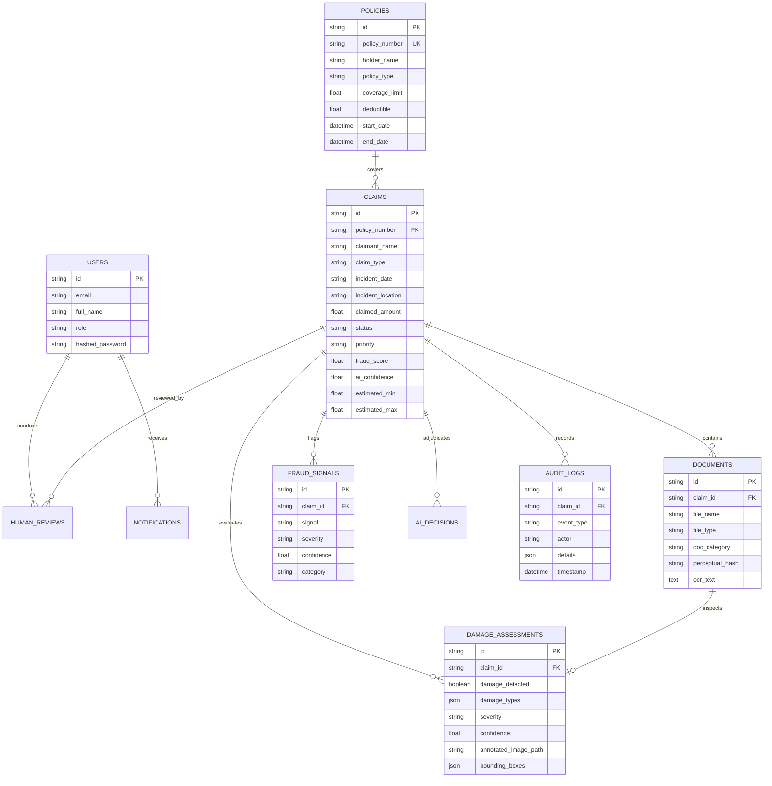
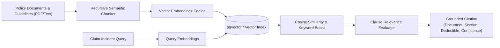
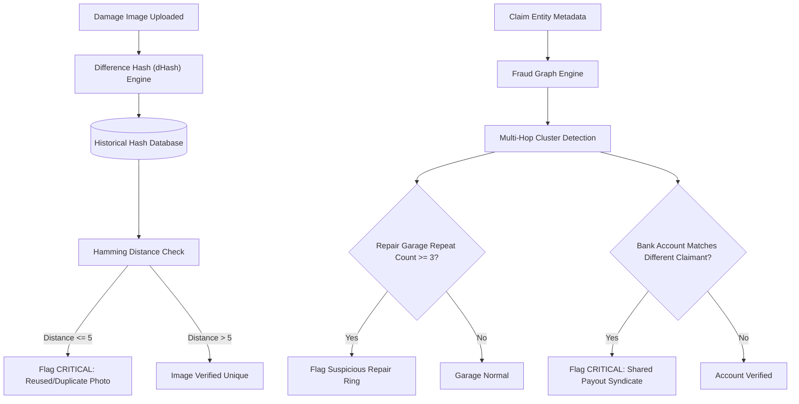
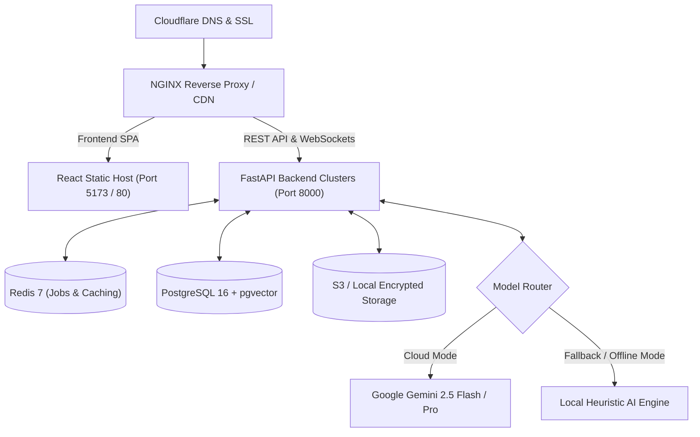

# InsurAI Triage — End-to-End Multimodal Insurance Claim Triage AI Agent Platform

[](https://github.com/organization/insurance-claim-agent/actions/workflows/ci.yml)
[](https://fastapi.tiangolo.com)
[](https://reactjs.org)
[](https://www.typescriptlang.org)
[](https://python.org)
[](https://tailwindcss.com)
[](https://www.docker.com)

> **InsurAI Triage** is an enterprise-grade, production-ready, autonomous multi-agent insurance claim adjudication platform. It ingests complex multimodal inputs (high-resolution damage photos, scanned police FIRs, contractor repair invoices, audio accident statements, and policy documents), cross-examines evidence across a network of 11 specialized AI agents, uncovers fraud syndicates, computes fair payout estimates, enforces strict human-in-the-loop governance, and provides plain-English explainability for claims adjusters.

---

## Table of Contents
1. [Problem Statement & Solution](#problem-statement--solution)
2. [Multi-Agent Architecture](#multi-agent-architecture)
3. [Architecture Diagrams](#architecture-diagrams)
   - [System Architecture](#system-architecture)
   - [Agent Orchestration State Machine](#agent-orchestration-state-machine)
   - [Database Entity-Relationship Diagram](#database-entity-relationship-diagram)
   - [Policy RAG Grounding Pipeline](#policy-rag-grounding-pipeline)
   - [Fraud Graph & Duplicate Hashing Pipeline](#fraud-graph--duplicate-hashing-pipeline)
   - [Cloud Deployment Topology](#cloud-deployment-topology)
4. [Agent Catalog](#agent-catalog)
5. [Key Capabilities](#key-capabilities)
6. [Tech Stack & Folder Structure](#tech-stack--folder-structure)
7. [Getting Started](#getting-started)
   - [Local Development Setup](#local-development-setup)
   - [Docker Compose Quickstart](#docker-compose-quickstart)
   - [Demo Personas & Seed Credentials](#demo-personas--seed-credentials)
8. [API Reference & OpenAPI Specification](#api-reference--openapi-specification)
9. [What-If Decision Simulator & Adjuster Workbench](#what-if-decision-simulator--adjuster-workbench)
10. [Automated Testing & CI/CD](#automated-testing--cicd)
11. [Security, Privacy & Compliance](#security-privacy--compliance)

---

## Problem Statement & Solution

Traditional claims processing suffers from:
- **Long Adjudication Cycles**: 48 to 72 hours manual turnaround per claim.
- **Undetected Fraud Syndicates**: Fraud rings recycling vehicle damage photos across different claims, forging repair shop invoices, or staging hit-and-runs.
- **Inconsistent Estimations**: Subjective human adjuster assessments resulting in either over-payouts or customer disputes.
- **Hallucinating AI Models**: Generic chatbots inventing policy clauses or approving claims without citations.

### The InsurAI Solution
- **True Multi-Agent Architecture**: 11 decoupled agents running in parallel and pipeline stages communicating via typed Pydantic state.
- **Zero Policy Hallucination**: Strict RAG clause retrieval with exact citations (source document, clause section, deductible applied, and confidence).
- **Perceptual Image Hashing (dHash)**: Identifies identical or subtly cropped photos reused across past claims regardless of filename changes.
- **Claim Entity Network Graph**: Detects multi-party clusters (Claimant $\leftrightarrow$ Vehicle $\leftrightarrow$ Repair Shop $\leftrightarrow$ Payout Account).
- **Human-in-the-Loop Governance**: Senior adjusters must provide an auditable override reason when reversing AI recommendations.
- **Decision Simulator**: Adjust claimed amounts, fraud thresholds, and repair scopes in real-time to preview decision transitions.

---

## Architecture Diagrams

### System Architecture


---

### Agent Orchestration State Machine


---

### Database Entity-Relationship Diagram


---

### Policy RAG Grounding Pipeline


---

### Fraud Graph & Duplicate Hashing Pipeline


---

### Cloud Deployment Topology


---

## Agent Catalog

| Agent | Responsibility | Core Outputs |
| :--- | :--- | :--- |
| **Agent 1 — Intake Agent** | Ingests claim, verifies modalities, transcribes audio statements, flags missing information. | `submitted_modalities`, `missing_information`, `initial_summary` |
| **Agent 2 — Document AI Agent** | OCR parser for police reports, repair invoices, receipts. Extracts key-value tables with confidence scores. | `extracted_fields`, `confidence_scores`, `raw_text_preview` |
| **Agent 3 — CV Damage Agent** | Computer vision defect locator. Generates annotated bounding box images, classifies damage severity. | `damage_detected`, `severity`, `bounding_boxes`, `annotated_image_path` |
| **Agent 4 — Claim Understanding** | Synthesizes customer narrative, evidence, and documents into a normalized claim state. | `normalized_claim` |
| **Agent 5 — Policy Coverage RAG** | Indexes corporate policies and retrieves applicable coverage clauses without hallucination. | `coverage_applicable`, `deductible`, `citations` |
| **Agent 6 — Fraud Detection Agent** | Cross-references image perceptual hashes, entity graph clusters, and timeline conflicts. | `fraud_score` (0-100), `risk_level`, `signals` |
| **Agent 7 — Claim Severity Agent** | Calculates damage, financial exposure, urgency, and configurable priority scores. | `damage_severity`, `financial_severity`, `priority_score` |
| **Agent 8 — Estimation Agent** | Benchmarks parts, labor, GST, depreciation, and deductibles into a valuation range. | `estimated_min`, `estimated_max`, `breakdown` |
| **Agent 9 — Decision Engine** | Adjudicates claim status against configurable business rules and safety guardrails. | `recommendation` (AUTO_APPROVE, MANUAL_REVIEW, FLAGGED, etc.) |
| **Agent 10 — Explainability Agent** | Generates non-technical plain-English rationales, evidence citations, and adjuster action guides. | `why`, `evidence`, `recommended_action` |
| **Agent 11 — Multilingual Agent** | Generates localized customer status updates in English, Hindi, and Kannada. | `customer_messages` (`en`, `hi`, `kn`) |

---

## Key Capabilities

1. **Multimodal Ingestion**: Supports simultaneous text descriptions, vehicle damage photos, scanned PDFs, repair invoices, and voice audio notes.
2. **Interactive Damage Annotator**: Toggle between raw photographs and bounding-box overlays showing detected structural defects and confidence scores.
3. **What-If Decision Simulator**: Interactive sliders allowing adjusters to simulate the impact of varying claimed amounts, fraud scores, or model confidence.
4. **Senior Adjuster Sign-Off**: Mandatory override reasoning logged immutably into the audit trail when overriding AI recommendations.
5. **Real-time Pipeline Streaming**: Live WebSocket milestones broadcasting pipeline stages (`Uploading` $\rightarrow$ `Reading documents` $\rightarrow$ `Analyzing images` $\rightarrow$ `Checking policy` $\rightarrow$ `Checking anomalies` $\rightarrow$ `Estimating claim` $\rightarrow$ `Generating decision`).
6. **AI Claim Copilot**: Grounded assistant answering natural language questions with policy citations.
7. **Exportable Claim Dossiers**: Generates downloadable formal claim reports.

---

## Tech Stack & Folder Structure

```
insurance-claim-agent/
├── backend/
│   ├── app/
│   │   ├── api/v1/          # REST & WebSocket Endpoints (auth, claims, copilot, fraud, analytics, ws)
│   │   ├── agents/          # 11 Specialized AI Agents (intake, vision, fraud, policy RAG, decision, etc.)
│   │   ├── workflows/       # Multi-Agent Workflow State Orchestrator
│   │   ├── core/            # Config, SQLAlchemy DB, JWT Security, LLM Provider Abstraction
│   │   ├── models/          # Relational Schemas (claims, documents, damage, fraud, audit logs)
│   │   ├── schemas/         # Typed Pydantic v2 Models
│   │   ├── services/        # dHash Hasher, Fraud Graph, Timeline Service, Policy RAG, Synthetic Generator
│   │   └── main.py          # FastAPI Application Entrypoint
│   ├── tests/               # Pytest Unit & Integration Test Suites
│   ├── seed_data.py         # Demo Database Seeder (Users, Policies, Multimodal Claims)
│   ├── requirements.txt     # Python Dependencies
│   └── Dockerfile           # Backend Container
├── frontend/
│   ├── src/
│   │   ├── api/             # Typed API Client
│   │   ├── components/      # Navbar, LivePipelineModal, DamageAnnotator
│   │   ├── pages/           # Dashboard, ClaimsList, ClaimDetail, CustomerPortal, FraudNetwork, Analytics, Copilot, Knowledge, Settings, Audit
│   │   ├── types/           # TypeScript Data Contracts
│   │   ├── App.tsx          # Master App Layout & State
│   │   └── main.tsx         # React DOM Entrypoint
│   ├── package.json         # Node Dependencies
│   ├── vite.config.ts       # Vite Bundler & Reverse Proxies
│   ├── tailwind.config.js   # Tailwind Configuration
│   └── Dockerfile           # Production Multi-Stage NGINX Container
├── docker-compose.yml       # Full Stack (Backend, Frontend, Postgres + pgvector, Redis)
├── .env.example             # Config Template
├── .github/workflows/ci.yml # Automated CI/CD
└── README.md
```

---

## Getting Started

### Quick Commands (clean Linux machine)

```bash
# 1 — Clone
git clone https://github.com/organization/insurance-claim-agent.git
cd insurance-claim-agent

# 2 — Configure secrets
cp .env.example .env
# Edit .env: set JWT_SECRET to a random value, e.g.:
#   python3 -c "import secrets; print(secrets.token_hex(32))"

# 3 — Build & run (Docker — recommended, zero host deps needed)
docker compose up --build

# 4 — Test (requires Python 3.12)
python -m pip install -r backend/requirements-dev.lock
python -m pytest backend/tests -v
```

| Service | URL |
|---------|-----|
| Frontend UI | http://localhost:5173 |
| Backend API | http://localhost:8000 |
| OpenAPI Docs | http://localhost:8000/docs |

---

### Local Development Setup (without Docker)

#### Prerequisites
- **Python 3.12** (or use `pyenv`: `.python-version` is already set)
- **Node.js 20+** and **npm**

#### 1. Backend Setup
```bash
# Create and activate a virtual environment
python3 -m venv .venv
source .venv/bin/activate        # Windows: .venv\Scripts\activate

# Install exact locked dependencies
pip install -r backend/requirements-dev.lock

# Configure environment variables
cp .env.example .env
# Set JWT_SECRET in .env (mandatory — app will not start without it)

# Seed the demo database
python -m backend.seed_data

# Run the API server (hot-reload)
uvicorn backend.app.main:app --host 0.0.0.0 --port 8000 --reload
```
API: **`http://localhost:8000`** · Docs: **`http://localhost:8000/docs`**

#### 2. Frontend Setup
```bash
cd frontend

# Install exact locked dependencies
npm ci

# Start Vite dev server
npm run dev
```
Frontend: **`http://localhost:5173`**

---

### Docker Compose (full stack)

```bash
# Copy and configure environment first
cp .env.example .env   # then edit JWT_SECRET

# Build and start all services (backend, frontend, Postgres, Redis)
docker compose up --build

# Stop
docker compose down
```

Services started:
- **Backend** — FastAPI on port 8000
- **Frontend** — React/Nginx on port 5173→80
- **PostgreSQL + pgvector** — port 5432
- **Redis 7** — port 6379

---

### Demo Personas & Seed Credentials

| Role | Email | Password | Access Scope |
| :--- | :--- | :--- | :--- |
| **Senior Adjuster** | `reviewer@insurance.ai` | `Reviewer@123` | Claims triage queue, damage inspections, override actions, copilot. |
| **Claims Admin / CCO** | `admin@insurance.ai` | `Admin@123` | Full system access, threshold governance, model routing, analytics. |
| **Policyholder** | `customer@insurance.ai` | `Customer@123` | Self-service submission, multilingual notifications, status tracker. |

---

## API Reference & OpenAPI Specification

All endpoints are versioned under `/api/v1` and documentable at `/docs`:

- **Authentication**:
  - `POST /api/v1/auth/login` — Authenticate and obtain JWT bearer token.
  - `POST /api/v1/auth/register` — Register a customer or adjuster account.
- **Claims Management**:
  - `GET /api/v1/claims` — List claims with status, priority, and search filters.
  - `POST /api/v1/claims` — Submit a structured claim dossier.
  - `GET /api/v1/claims/{id}` — Retrieve complete claim state, evidence, assessments, and audit logs.
  - `POST /api/v1/claims/{id}/documents` — Upload multimodal files (images, PDFs, audio).
  - `POST /api/v1/claims/{id}/analyze` — Trigger the autonomous multi-agent pipeline.
  - `GET /api/v1/claims/{id}/timeline` — Retrieve reconstructed chronological event timeline.
  - `GET /api/v1/claims/{id}/similar` — Semantic similarity search against historical precedents.
  - `POST /api/v1/claims/{id}/review` — Human adjuster review and override with mandatory justification.
  - `GET /api/v1/claims/{id}/report` — Export structured formal claim report.
  - `POST /api/v1/claims/synthetic` — Developer endpoint generating realistic synthetic claims.
- **AI Copilot & Policy RAG**:
  - `POST /api/v1/copilot/chat` — Grounded conversational adjuster query with citations.
  - `GET /api/v1/knowledge` — List indexed underwriting policy terms.
  - `POST /api/v1/knowledge/query` — Semantic vector retrieval testbed.
- **Fraud Intelligence**:
  - `GET /api/v1/fraud/overview` — Portfolio-wide fraud telemetry and suspicious repair garages.
  - `GET /api/v1/fraud/network-graph/{id}` — Multi-hop entity relationship graph.
- **Executive Analytics & Administration**:
  - `GET /api/v1/analytics/dashboard` — KPIs, loss trends, cost savings, and risk heatmap.
  - `GET /api/v1/admin/configs` — Inspect current business rules & thresholds.
  - `PUT /api/v1/admin/configs` — Update fraud thresholds, high-value limits, SLA rules.
  - `POST /api/v1/simulator/evaluate` — What-If scenario decision simulation.
- **Real-Time WebSockets**:
  - `WS /api/v1/ws/triage/{id}` — Live pipeline milestone streaming.

---

## Automated Testing & CI/CD

One command runs the full test suite from the repo root:

```bash
python -m pytest backend/tests -v
```

> **Note:** Run from the repo root (not `backend/`). `pyproject.toml` sets `PYTHONPATH=.` automatically so `from backend.app...` imports resolve correctly. `conftest.py` boots an in-memory SQLite database and seeds demo data — no pre-existing `.env` or database needed.
All unit and integration tests execute across:
- `test_intake_agent`: Modality identification and validation.
- `test_fraud_agent_duplicate_image`: Hamming distance perceptual dHash collision detection.
- `test_decision_agent_guardrail`: Adjudication thresholds and human review routing.
- `test_image_hasher_hamming`: Perceptual hashing accuracy.
- `test_health_check`: Gateway availability.
- `test_auth_login_admin`: JWT generation and bcrypt password hashing.
- `test_list_claims` & `test_get_claim_detail`: Data persistence and querying.
- `test_simulator`: What-If decision simulation engine.

---

## Security, Privacy & Compliance

1. **Zero Secret Leakage**: No hardcoded secrets or API tokens. Controlled via `.env`.
2. **Strict RBAC & JWT Authentication**: Claims adjusters and admins access triage intelligence; customers access only their submitted claims.
3. **Internal Telemetry Shielding**: Internal fraud scores and suspicious network indicators are strictly isolated from the public Customer Portal.
4. **Immutable Audit Trails**: Every document upload, OCR event, AI agent decision, and human adjuster override is immutably timestamped in `audit_logs`.
5. **Decoupled Fallback Engine**: Local deterministic engine ensures operational resilience even during external cloud provider outages.

---

&copy; 2026 InsurAI Triage Platform &bull; Autonomous Multimodal Decision Support &bull; Enterprise SaaS
